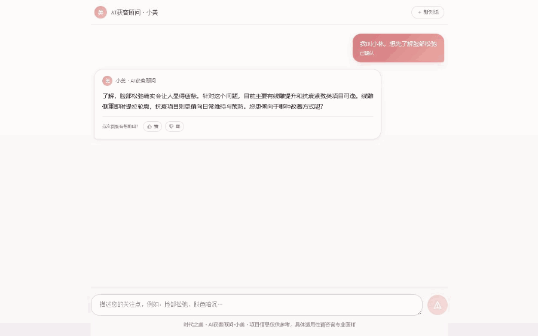
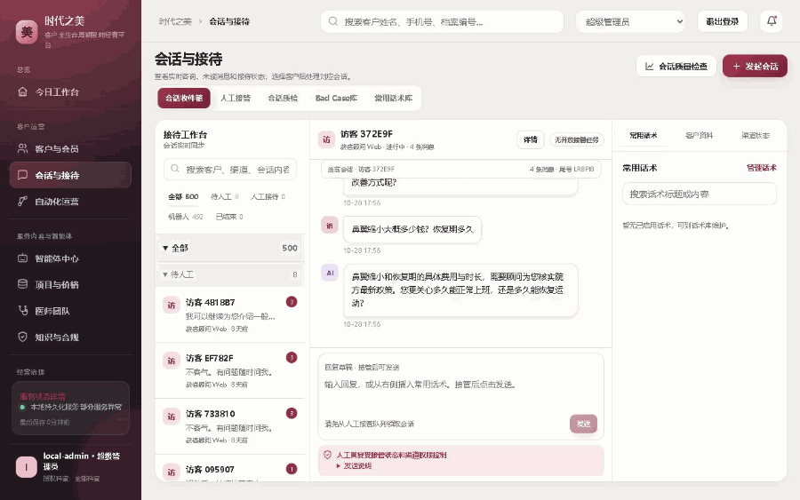
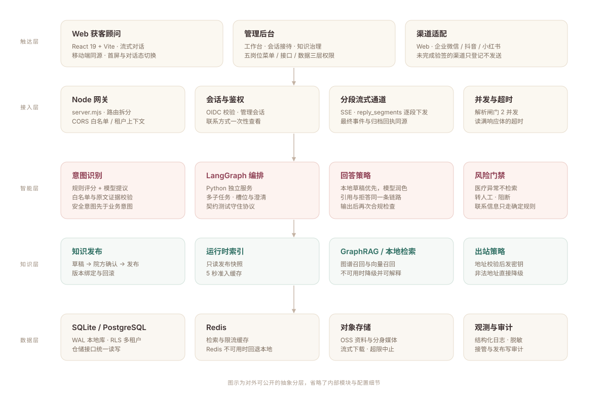
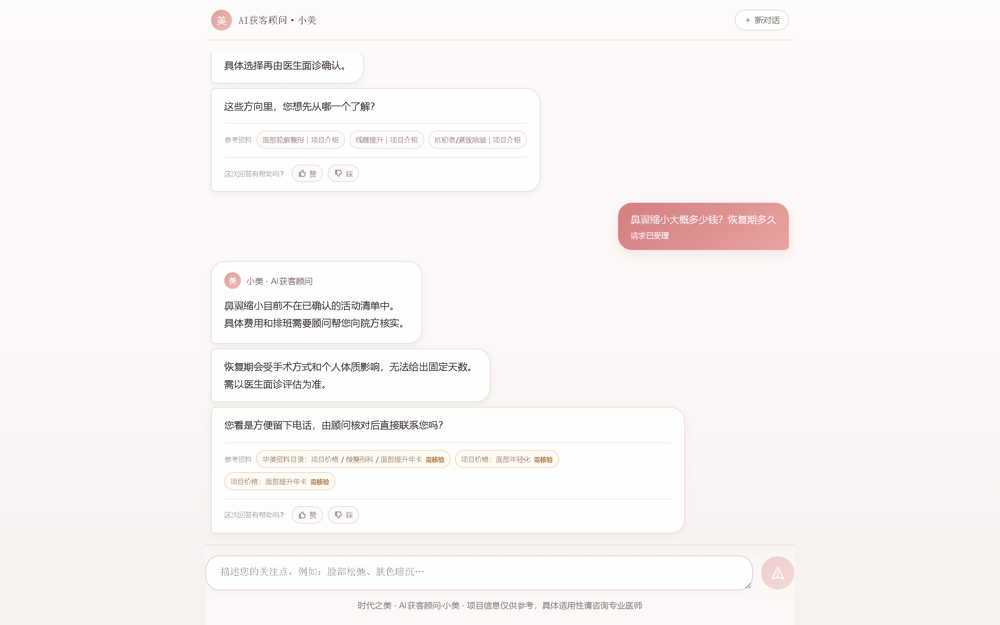
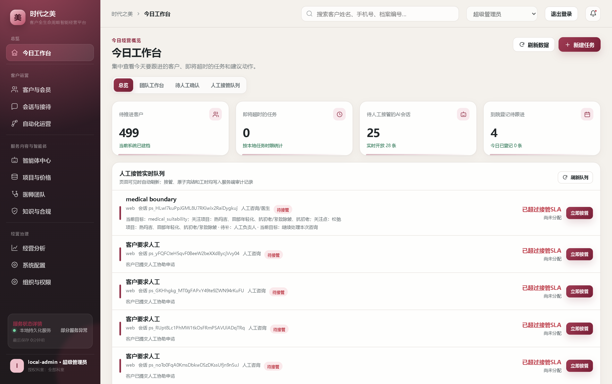
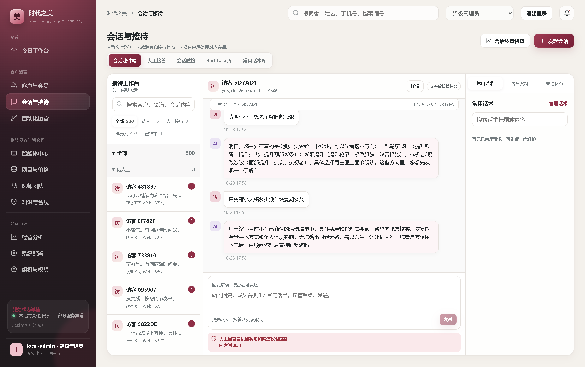
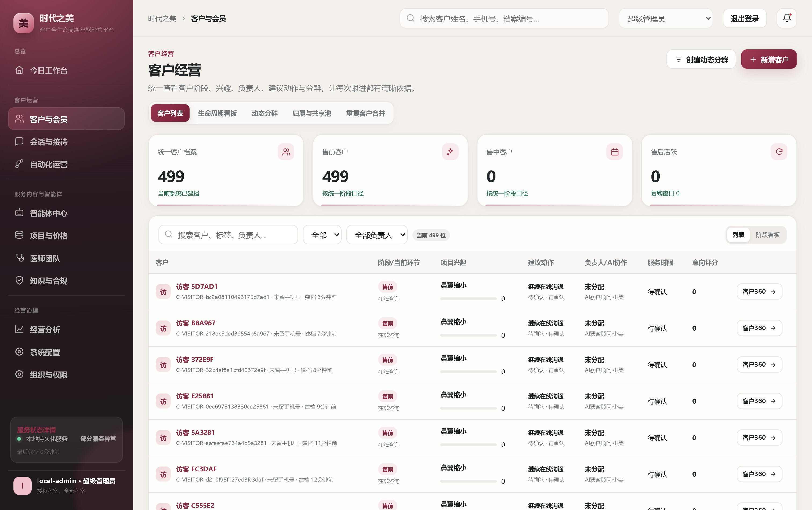
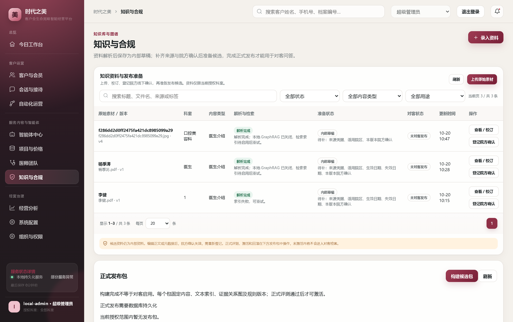

# 华美 · 医美客户全生命周期 AI 售前系统

一个把大模型售前对话做成**可交付系统**的工程实践：意图路由、证据约束回答、人工接管闭环、以及能被反复验证的测试与安全门禁。

`Node 24` · `React 19 / Vite` · `LangChain / LangGraph` · `GraphRAG` · `SQLite / PostgreSQL` · `Redis` · `OSS`



---

## 这是什么

医美的售前咨询有三条硬约束：项目多、价格政策随时变、说错一句就是医疗合规事故。所以这个系统不是"接个大模型聊天"，而是把一条咨询拆成可核验的链路：

**识别意图 → 找到已审核的证据 → 在证据边界内生成回答 → 需要人时交给人。**

- 前台是面向客户的对话入口（AI 获客顾问"小美"），支持多轮、纠正、留资和预约意向。
- 后台是运营侧的工作台：会话接待、人工接管、客户 360、知识发布与治理、五岗位权限。
- 知识侧要求"先审核、再发布、可回滚"，对客回答只能引用已发布的版本。

## 我负责的部分

三人协作项目，我负责 **A 线：智能体与前台对话**。

| 范围 | 内容 |
| --- | --- |
| 前台应用 | `apps/acquisition-advisor`：对话流、输入连续性、异常恢复、移动端 |
| 对话内核 | 意图识别、任务推进与槽位、多轮上下文与纠正、回答策略 |
| 模型接入 | 受控调用、上下文最小化、响应体边界、并发与降级 |
| 评测 | 对话评测集、意图准确率回归、路由准确率报告 |

其余两条线（客户与人工接待、知识发布与岗位权限）由另外两位同事负责，本仓库一并说明是因为对话链路必须穿过它们才算真正闭环。

## 三个关键设计

### 1. 意图识别：让模型提议，由程序裁决

纯规则的意图树覆盖不了口语变体，纯模型的意图识别又不可控。这里的做法是分层：

1. **确定性安全门禁先跑**——医疗异常、个体适用性、隐私客诉、越权套取，直接走接管或阻断，不进入业务检索。
2. **实体与动作分离**——"李健院长"是医生实体，"介绍 / 比较 / 查排班 / 预约"是对话动作，两者组合才形成意图。
3. **模型只提议**——可以给出一个主意图和最多三个有序子任务，但必须通过白名单、原文证据、槽位来源校验，通不过就退回规则结果。
4. **当前轮优先**——本轮明确提到的项目覆盖历史兴趣，避免上一轮主题污染本轮判断。

评测集覆盖 39 个专项意图案例、132 个策划安全样本、396 段多轮对话；发布门禁要求意图准确率、实体链接、澄清判断均不低于 95%。

> 细节见 [docs/02-intent-routing.md](docs/02-intent-routing.md)

### 2. 证据约束回答：先有资料，再有措辞

每个意图都绑定一条固定证据路线，回答生成分两步：

- **本地先出草稿**：只使用已发布知识里命中的片段，拼出可追溯的结构化回复，附带引用。
- **模型只做润色**：输入上下文只含分类结果和脱敏字段，不含完整历史；输出的措辞再过一道合规检查。

没有证据时不允许"用相似资料补答"，而是追问一个关键问题，或请人工核验。价格、有效期、排班这类内容一律给核验口径，不报历史价。

> 细节见 [docs/03-grounded-answer.md](docs/03-grounded-answer.md)

### 3. 分段流式，但结果必须可归档

前台看到的是逐段出现的回答，但流式只是传输形态：每个段落先落库，最终事件携带与普通 JSON 接口一致的完整回执，保证"用户看到的"和"后台归档的"是同一份内容。刷新页面后会话可恢复，人工接管时 AI 立即停止对外发送。



> 细节见 [docs/04-handover-loop.md](docs/04-handover-loop.md)

## 系统一览



## 工程化：能被验证的部分

| 项目 | 结果 |
| --- | --- |
| 测试用例 | 289 条，分层为 unit / integration / postgres / browser / live |
| 安全红队 | 64 / 64 通过 |
| 生产依赖审计 | 0 漏洞（123 个生产依赖） |
| 客户快照 gzip | 81,176 → 11,071 字节 |
| 客服快照响应（501 客户，本地 SQLite） | 约 84ms → 27–32ms |
| 提交节奏 | 2026-09-10 → 2026-10-21，206 次提交 |

测试不是"跑通就行"：每个测试文件在 `tests/manifest.mjs` 里登记分类，CI 按类别跑；PostgreSQL 相关用例在隔离库和隔离角色里执行，跑完清理；安全用例覆盖越权、注入、XSS 边界和联系方式泄露。

> 细节见 [docs/05-engineering-quality.md](docs/05-engineering-quality.md)

## 界面

| 前台首屏 | 前台对话 |
| --- | --- |
|  |  |

| 今日工作台 | 会话与接待 |
| --- | --- |
|  |  |

| 客户与会员 | 知识与合规 |
| --- | --- |
|  |  |

<p align="center">
  
</p>

## 目录

```
docs/01-architecture.md     分层、进程边界与数据流
docs/02-intent-routing.md   意图识别与任务推进
docs/03-grounded-answer.md  证据约束、引用与拒答
docs/04-handover-loop.md    流式回答与人工接管闭环
docs/05-engineering-quality.md 测试分层、门禁与性能数据
```

## 运行方式

```bash
npm ci
npm --prefix apps/acquisition-advisor ci
npm run team:init      # 生成本机开发账号，不复制负责人账号
npm run dev            # 前台 http://127.0.0.1:4173/advisor/
```

默认使用本地 SQLite，不访问院方接口；模型和 GraphRAG 可以关闭，关闭后走本地检索与确定性回答，功能链路仍然完整。

## 说明与边界

- 这是一个**三人协作**的交付型项目，本仓库只公开了脱敏后的说明、界面截图和演示动图，**不含业务源码、客户数据、知识库原文和任何凭据**。
- 截图中的客户名称、手机号、会话编号均已脱敏；演示对话使用虚构访客。
- 性能与评测数字来自本地开发环境，用于说明工程方法，不构成生产容量承诺。
- 文中所有"可以上线"的判断都以已执行的测试为限，未执行的部分会明确标注为未验证。

---

<sub>如果你在找一位能把 AI 原型推进到生产边界的工程师，欢迎通过 GitHub Issue 或主页联系方式找我。</sub>
